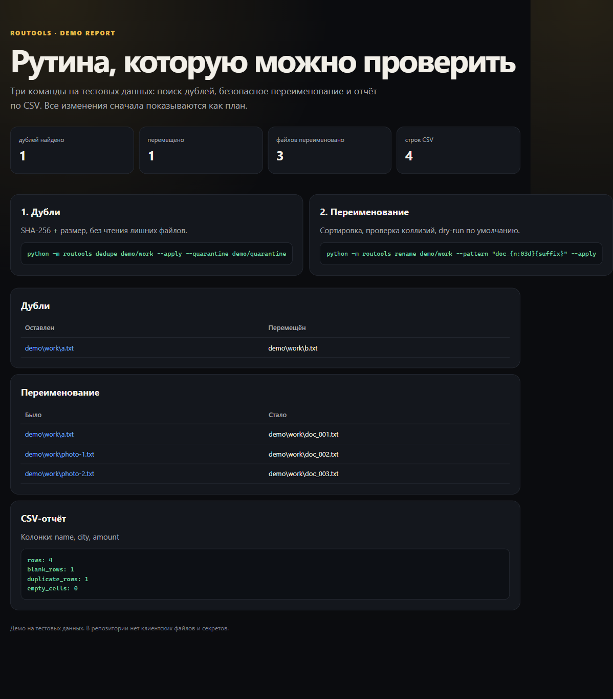

# kwork-python-scripts

Небольшие CLI-утилиты на Python для рутины с файлами и CSV. Без внешних зависимостей: нужен только Python 3.10+.



## Что уже работает

- `dedupe` — находит одинаковые файлы по SHA-256 и размеру, по умолчанию показывает план, с `--apply` переносит дубли в quarantine вместо удаления.
- `rename` — пакетное переименование с шаблоном, сортировкой, проверкой коллизий и dry-run по умолчанию.
- `csv-report` — считает строки, пустые строки, дубли и пустые ячейки в CSV.

## Быстрый старт

```bash
python -m routools --help
python -m routools dedupe examples/files
python -m routools rename examples/files --pattern "photo_{n:03d}{suffix}"
python -m routools csv-report examples/invoices.csv
```

Применить изменения на копии примеров:

```bash
mkdir -p demo
cp -r examples/files demo/work
python -m routools dedupe demo/work --apply --quarantine demo/quarantine
python -m routools rename demo/work --pattern "doc_{n:03d}{suffix}" --apply
```

`--apply` у `dedupe` **перемещает**, а не удаляет файлы. Quarantine можно проверить и удалить вручную.

## Демо

```bash
python scripts/build_demo.py
```

Скрипт создаёт `demo/work`, `demo/quarantine`, `demo/report.json` и `demo/index.html`. После запуска откройте `demo/index.html` в браузере.

## Тесты

```bash
python -m unittest discover -s tests -v
```

Проверяются поиск дублей, безопасное перемещение, переименование, защита от коллизий, CSV-отчёт и CLI.

## Ограничения

- Это локальные утилиты, а не облачный сервис и не планировщик.
- `dedupe` сравнивает содержимое файлов; для очень больших каталогов нужен запас по I/O и времени.
- `rename` не меняет содержимое файлов и не переименовывает каталоги.
- CSV-отчёт рассчитан на таблицы с одной строкой заголовка; сложные многострочные CSV требуют отдельной настройки.
- Нет интеграций с Google Sheets, CRM и Telegram. Это отдельные карточки и отдельные репозитории.

## Структура

```text
routools/          CLI и модули
examples/          тестовые файлы и CSV
scripts/           сборка демо
tests/             unittest
demo/              сгенерированный отчёт
docs/              архитектура и границы
```

## Лицензия

MIT.
